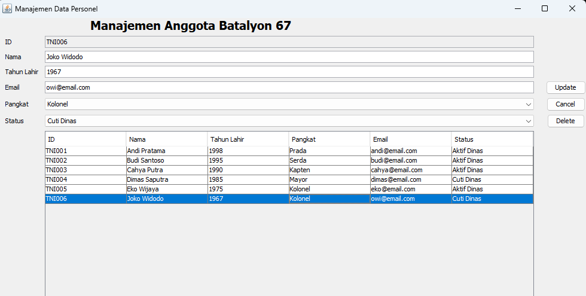
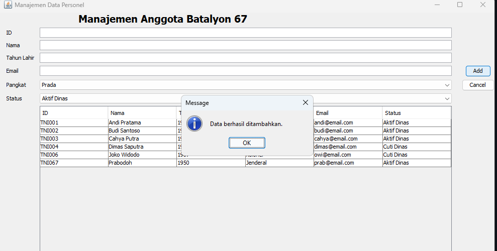
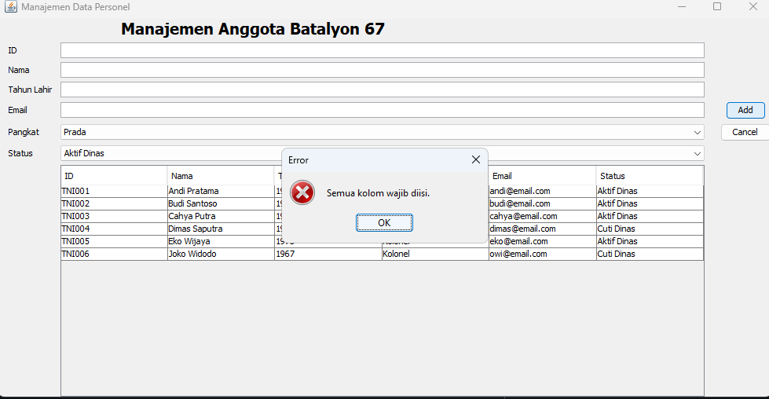
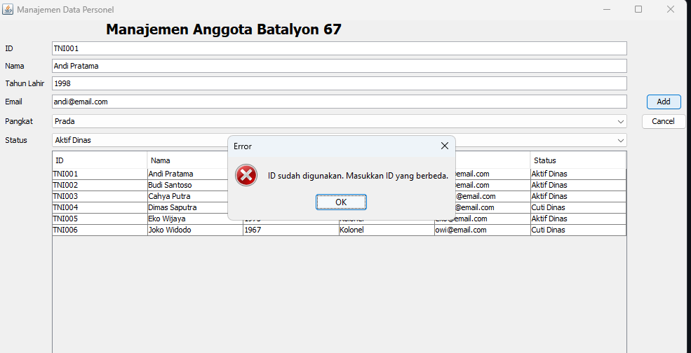
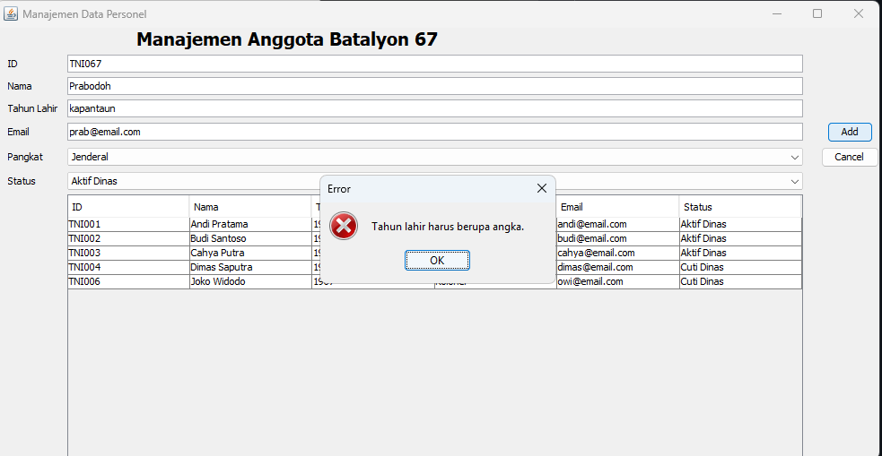
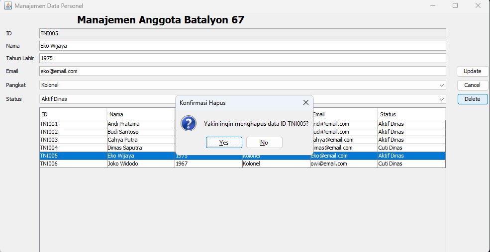
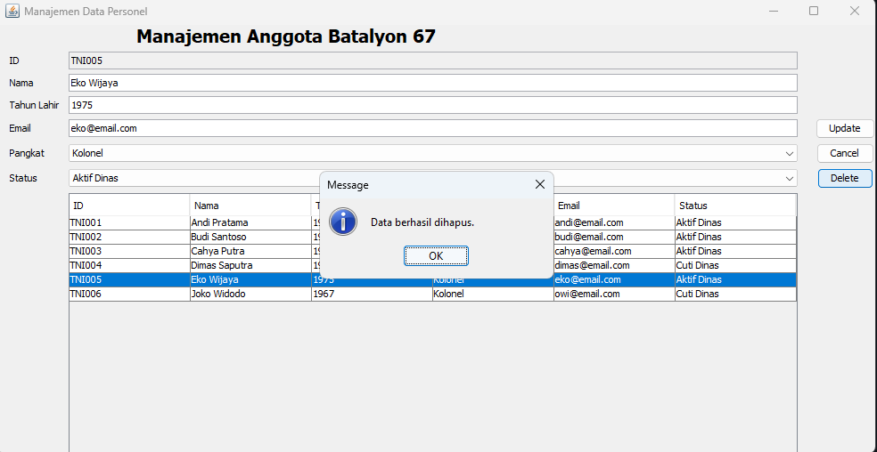
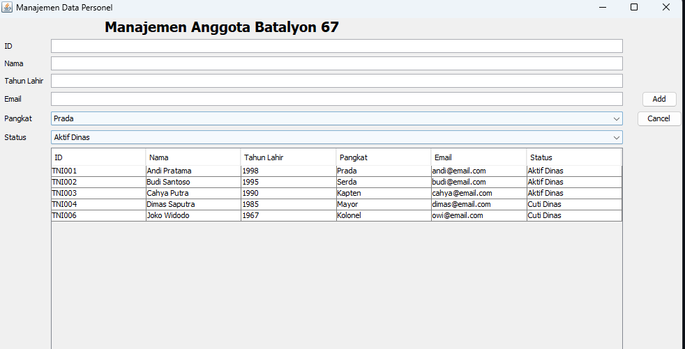

# TP5DPBO2526C2
## Janji

Saya Nabil Azka Saputra dengan NIM 2507096 mengerjakan TP2 dalam mata kuliah DPBO untuk keberkahanNya maka saya tidak melakukan kecurangan seperti yang telah dispesifikasikan. Aamiin

##  Penjelasan Design

Untuk desain program ini aku menggunakan tema **Manajemen Data Personel**. Data personel disimpan dalam database dan ditampilkan melalui tabel pada aplikasi Java Swing. Setiap personel memiliki ID, nama, tahun lahir, pangkat, email, dan status dinas. Pilihan pangkat menggunakan daftar pangkat, sedangkan status terdiri dari **Aktif Dinas** dan **Cuti Dinas**.

**Desain Program**

1. **Model (Representasi Data — `Person.java`)** Berfungsi sebagai kelas untuk menampung data personel, yaitu `id`, `nama`, `tahunLahir`, `pangkat`, `email`, dan `status`. Kelas ini dilengkapi constructor, getter, dan setter.
2. **Database Handler (`Database.java`)** Menghubungkan aplikasi ke database MySQL `db_people` melalui JDBC. Method `selectQuery(sql)` digunakan untuk membaca data, sedangkan `insertUpdateDeleteQuery(sql)` digunakan untuk menambah, mengubah, dan menghapus data.
3. **View & Controller (`PeopleMenu.java` dan `PeopleMenu.form`)** Mengatur GUI menggunakan Java Swing, termasuk form input, pilihan pangkat dan status, tabel data, serta tombol Add, Update, Delete, dan Cancel. Kelas ini juga menangani validasi input dan aksi pengguna.

**Alur Program**

1. **Inisialisasi aplikasi:** Program membuka jendela `PeopleMenu` dan membuat koneksi ke database MySQL `db_people`.
2. **Menampilkan data (Read):** Data dari tabel `person` diambil menggunakan query `SELECT`, lalu ditampilkan pada `JTable` ketika aplikasi dibuka.
3. **Menambahkan data (Create):** Pengguna mengisi ID, nama, tahun lahir, email, lalu memilih pangkat dan status. Program memeriksa agar semua kolom terisi, ID belum digunakan, tahun lahir berupa angka dalam rentang 1950 hingga tahun sekarang, dan format email valid. Jika valid, data disimpan ke database dan tabel diperbarui.
4. **Mengubah data (Update):** Pengguna memilih salah satu baris tabel. Data terpilih dimasukkan ke form dan kolom ID dikunci agar tidak berubah. Setelah tombol **Update** ditekan, perubahan disimpan ke database dan tabel dimuat ulang.
5. **Menghapus data (Delete):** Setelah memilih baris, pengguna menekan **Delete** dan mengonfirmasi penghapusan. Data dihapus berdasarkan ID, lalu tabel diperbarui.
6. **Membersihkan form (Cancel):** Tombol **Cancel** mengosongkan form, mengembalikan pilihan awal, dan membatalkan pemilihan baris.

## Dokumentasi

Seluruh screenshot disimpan di folder `dokumentasi/`.

**1. Tampilan utama aplikasi**

**2. Berhasil menambahkan data**

**3. Validasi ketika tidak ada data yang bisa ditambahkan**

**4. Validasi ID yang sudah digunakan**

**5. Validasi tahun lahir**

**6. Mengubah data personel, dari joko widodo jadi joko bapakgibran**

**7. Konfirmasi penghapusan data**

**8. Data berhasil dihapus**

**9. Hasil setelah penghapusan**

> **Catatan database:** `Database.java` menggunakan MySQL pada `localhost:3306`, database `db_people`, username `root`, dan password kosong. Pastikan database serta tabel `person` sudah tersedia sebelum menjalankan program.
